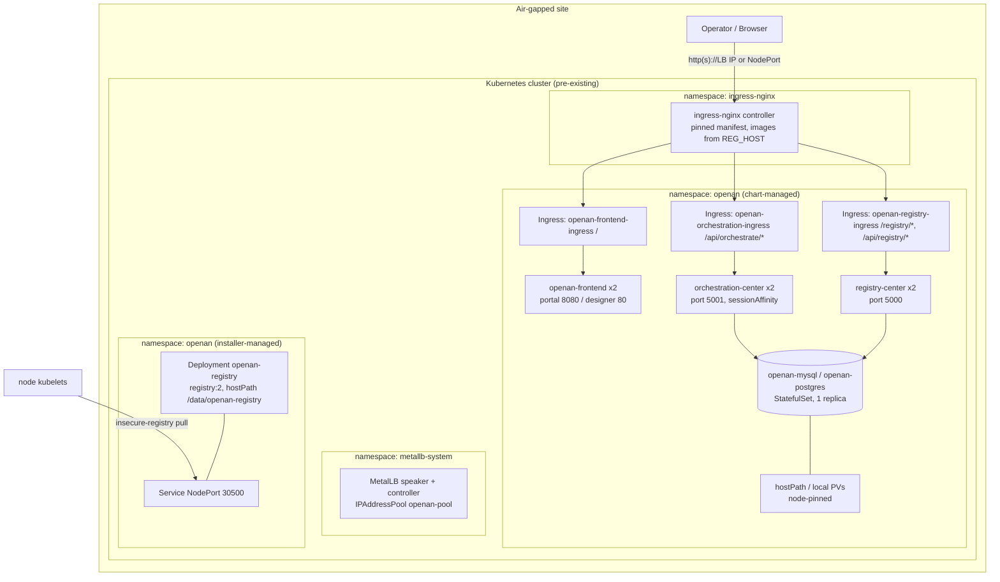
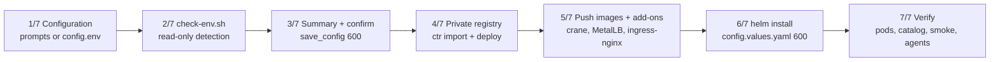
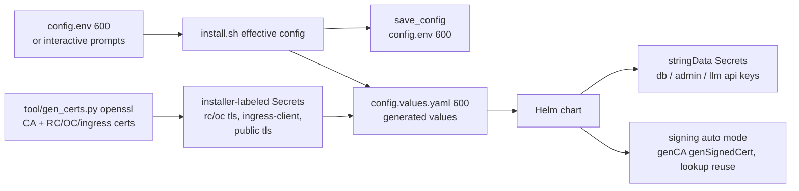
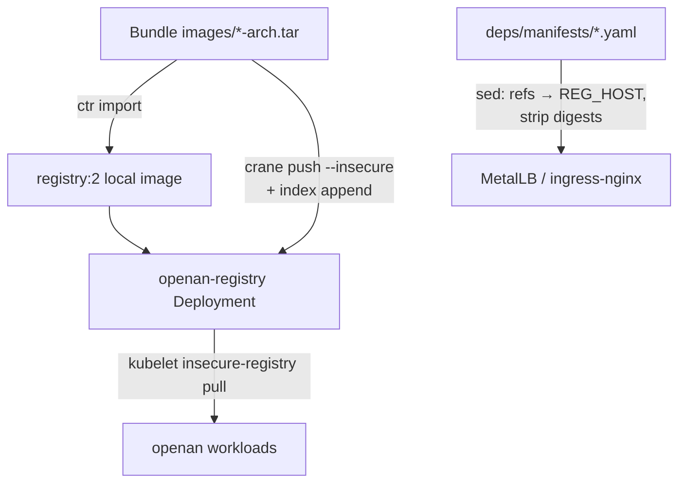
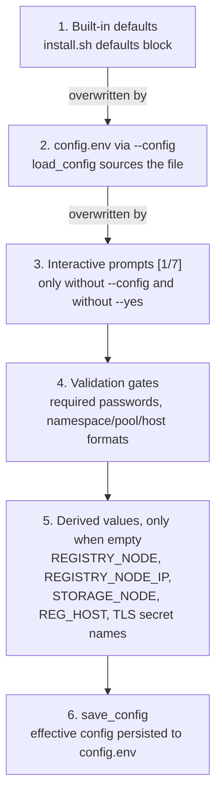

# Offline Kubernetes Installation Architecture Design

## 1. Overview

The `containerized/offline-install/` deliverable deploys the OpenAN platform
onto an **existing, air-gapped Kubernetes cluster** from a self-contained
bundle transferred to the target site. It consists of three cooperating
parts:

| Part | Artifact | Role |
|------|----------|------|
| Helm chart | `chart/` | Declarative resource definitions for the OpenAN workloads |
| Installer | `scripts/install.sh` (+ `check-env.sh`, `push-images.sh`, `lib/common.sh`) | Orchestrates configuration, the in-cluster registry, infra add-ons and `helm install` |
| Bundle | produced by `build/build-offline.sh` | Per-arch image tars, pinned binaries (helm/kubectl/crane), pinned infra manifests, chart, scripts, `SHA256SUMS` |

The installer **never uses the internet and never edits the OS or the
container runtime configuration** (`scripts/install.sh:9`). Image delivery
runs through an in-cluster `registry:2` populated with the bundled
[crane](https://github.com/google/go-containerregistry) over plain HTTP.

### Scope

- Target: a running kubeadm-style cluster (v1.33+ per `chart/Chart.yaml`
  `kubeVersion`), reachable with `kubectl` from the install node, with
  `ctr` access to the node containerd.
- Installs MetalLB and ingress-nginx from **pinned manifests inside the
  bundle** when they are absent.
- Interactive first run (prompts, masked secrets) or fully config-driven
  re-runs via `config.env`.

### Non-goals

- Cluster creation (see `docs/KUBEADM_CLUSTER.md` for a reference-only
  offline kubeadm build).
- Containerd trust configuration for the plain-HTTP registry — a manual
  per-node prerequisite (`docs/DEPENDENCIES.md` §2.2); the installer only
  **detects** it for the local node.
- Release upgrades: the installer **aborts if Helm release `openan` already
  exists** (`scripts/install.sh:516-520`); redeploy = uninstall + install.
- The online/interactive line and the Compose line (see
  `online-install-architecture.md` and `offline-install-compose-architecture.md`).

---

## 2. Architecture

### 2.1 Deployment topology



Two ownership domains coexist in the `openan` namespace: the chart-managed
workloads and the **installer-managed private registry** (Deployment +
NodePort Service written directly by `install.sh:248-309`, outside the Helm
chart; removed by `uninstall.sh:95-99`). An architecture view must not
assume everything in the namespace belongs to the release.

### 2.2 Component inventory

| Resource | Kind | Name | Notes |
|----------|------|------|-------|
| Private registry | Deployment | `openan-registry` | Installer-owned; `imagePullPolicy: Never`, node-pinned, hostPath `/data/openan-registry` |
| Private registry | Service | `openan-registry` | NodePort `30500` (`REGISTRY_NODEPORT`) |
| Registry Center | Deployment | `registry-center` | 2 replicas (installer-forced), preferred antiAffinity |
| Orchestration Center | Deployment | `orchestration-center` | 2 replicas; `seed-etc` init container; Service `sessionAffinity: ClientIP` (43200s) |
| Frontend | Deployment | `openan-frontend` | portal (8080, env-driven) or workflow-designer (80, chart-managed nginx via render init container) |
| Frontend | Service | `openan-frontend` | NodePort 30191 |
| Database | StatefulSet | `openan-mysql` / `openan-postgres` | Hardcoded 1 replica; init ConfigMap creates both app databases/users |
| Database PV | PV | `openan-mysql-pv` / `openan-postgres-pv` | Optional, node-pinned, Retain |
| Ingresses | Ingress | `openan-{frontend,orchestration,registry}-ingress` | Same path contract as the online chart |
| MetalLB config | CR | `openan-pool` / `openan-l2` | From `METALLB_POOL`; applied by the installer |

### 2.3 External dependencies

| Dependency | Source | Notes |
|------------|--------|-------|
| helm / kubectl / crane | `deps/bin/` in the bundle | Pinned (helm v3.19.5, kubectl v1.34.12, crane v0.19.2); bundle binaries win over PATH (`install.sh:87-98`) |
| ingress-nginx / MetalLB | `deps/manifests/` | Pinned (controller-v1.15.1, v0.16.1); image refs sed-rewritten to `REG_HOST`, digests stripped (`install.sh:346-348, 387-389`) |
| Containerd trust | Manual per node | `certs.d/<ip>:30500/hosts.toml` + restart; check-env warns for the local node only |
| Storage | Cluster or installer | Default StorageClass, or node-pinned hostPath PVs (see §3.4) |
| LLM | Internal endpoint | Probed only when `LLM_VALIDATE=true` (off by default offline) |

---

## 3. Component Design

### 3.1 Installer flow (seven phases)



- **Configuration** (`install.sh:105-141`): interactive prompts only when no
  `--config` file and not `--yes`; secrets are read masked from `/dev/tty`
  (`common.sh:88-112`). `OC_ADMIN_PASSWORD` is a hard gate — OC refuses to
  start over HTTP without a credential (`install.sh:143-147`).
- **check-env** (`check-env.sh`, 287 lines): read-only detector — bundle
  checksum, tooling, cluster, mixed-arch nodes, storage mode, ingress,
  MetalLB pool, containerd trust, per-arch image tars, NTP/disk; optional
  LLM probe. `--soft` never exits non-zero.
- **Confirm + persist**: the effective configuration round-trips to
  `config.env` (all 33 keys, chmod 600) so re-runs are non-interactive.
- **Private registry**: the only image imported directly into containerd
  (`ctr -n k8s.io images import`, `install.sh:235-243`); the registry itself
  runs from that local image with `imagePullPolicy: Never`.
- **Push images**: `push-images.sh` uses crane — single-arch tars are pushed
  straight to the final tag; multi-arch tars are pushed to `<tag>-<arch>`
  side tags and stitched into a manifest list with
  `crane index append --insecure` (`push-images.sh:93-107`). Crane speaks
  plain HTTP and needs no Docker daemon.
- **Helm install**: `config.values.yaml` is generated (chmod 600) and the
  install **aborts if the release exists** — no upgrade path.
- **Verify**: all pods Running (60×5s), registry catalog, optional agent
  examples server (`START_AGENTS_SERVER` → `kubectl exec` nohup
  `samples/start_agents_server.py`, best-effort), HTTP smoke tests on the
  three public paths.

### 3.2 Registry Center / Orchestration Center (Deployments)

Key differences from the online chart:

- **Replicas 2 + preferred podAntiAffinity** (installer sets
  `replicas: 2` for RC/OC/frontend), not the online line's single-replica
  enforcement. OC sessions remain process-local, so the Service sets
  `sessionAffinity: ClientIP` with a 12h timeout — cross-replica requests
  would otherwise 401 (`orchestration-center/service.yaml:15-23`).
- **OC `seed-etc` init container** copies the read-only image `etc/` into an
  emptyDir and renders `db_config.json` from its template — the image etc/
  is not writable at runtime (`orchestration-center/deployment.yaml:33-53`).
- **OC probes are tcpSocket :5001** — no unauthenticated HTTP endpoint
  exists (all routes 401 without a session). RC probes are httpGet on the
  agent-cards path, scheme following `https.enabled`.
- **Frontend**: portal renders its own nginx config from env
  (`BACKEND_URL`/`REGISTRY_URL`); workflow-designer uses a
  `render-nginx-config` init container (envsubst/sed into an emptyDir) so a
  read-only ConfigMap mount cannot crash the entrypoint.

### 3.3 Private registry (installer-managed)

`registry:2` pinned in the bundle, NodePort `30500`, hostPath
`/data/openan-registry` (`DirectoryOrCreate`), pinned to `REGISTRY_NODE`.
All workload image references are rewritten at install time to
`${REG_HOST}/<repo>:<tag>` (`install.sh:470-506`) — config.env carries
registry-relative refs only. `INSTALL_REGISTRY=false` assumes an external
registry at the same host and skips both deploy and push.

### 3.4 Databases and storage

- **MySQL 8.4.3 is the line default** (`DB_TYPE=mysql`,
  `config.env.example:67`); PostgreSQL 15 remains selectable. The chart's
  own default stays `postgresql`; the installer always emits
  `database.type`.
- Both are single-replica StatefulSets with utf8mb4 (mysql args) and an
  init script creating `registry_center`/`registry` and
  `orchestration_center`/`opena2a_t`.
- **Storage modes** (`STORAGE_MODE`): `auto` (default StorageClass when
  present, else hostPath fallback), `sc` (explicit `STORAGE_CLASS`),
  `hostpath`. The fallback creates the `openan-local` StorageClass
  (`no-provisioner`, WaitForFirstConsumer) plus a **node-pinned** PV
  (`mysql/storage.yaml`, `postgres/storage.yaml`) so a multi-node cluster
  never schedules the database away from its data.
- MySQL mode swaps the default hostPath to `/data/openan-mysql`
  (`install.sh:456-457`).

### 3.5 Validation

The chart validates via `_helpers.tpl` `fail()`s (database.type, database
host, frontend.type) plus shell-side checks in check-env/install. There is
no `validate.yaml` equivalent to the online chart — the installer is the
gatekeeper.

---

## 4. Data Flow

### 4.1 Request flow

Identical path contract to the online line: `/` → frontend,
`/api/orchestrate(/|$)(.*)` → OC (rewrite `/$2`), `/registry` +
`/api/registry` → RC. `backend-protocol: HTTPS` annotations follow
`https.enabled` (default on), with backend certificate verification
(`proxy-ssl-verify` + per-service SNI) when `ingress.backendVerifyServer`
is set; the ingress TLS block requires `ingress.tls.enabled` and a DNS
host.

### 4.2 Configuration flow



Secrets live on disk by design in this line (contrast: the online wizard
keeps secrets in memory and pipes them to `kubectl stdin`). Everything
generated is chmod 600 and gitignored (`config.env`, `config.values.yaml`).

### 4.3 Image flow



---

## 5. Configuration Contract

### 5.1 config.env (38 keys)

Grouped summary (authoritative list: `config.env.example`):

| Group | Keys |
|-------|------|
| Target | `K8S_NAMESPACE` |
| Private registry | `INSTALL_REGISTRY`, `REGISTRY_NODE`, `REGISTRY_NODE_IP`, `REGISTRY_NODEPORT` |
| Infra add-ons | `INSTALL_METALLB`, `METALLB_POOL`, `INGRESS_HOST` |
| Frontend | `FRONTEND_TYPE` (`portal` default) |
| Access control | `OC_ADMIN_PASSWORD` (required) |
| Transport security | `HTTPS_ENABLED` (default true), `HTTPS_VERIFY_CLIENT`, `RC_TLS_SECRET`, `OC_TLS_SECRET`, `INGRESS_CLIENT_SECRET`, `REGISTRY_CLIENT_SECRET` (optional OC→RC), `PUBLIC_TLS_SECRET` |
| Storage | `STORAGE_MODE`, `STORAGE_CLASS`, `STORAGE_SIZE`, `HOSTPATH`, `STORAGE_NODE` |
| Database | `DB_TYPE`, `DB_PASSWORD` (required, 8+) |
| Images | `REGISTRY_CENTER_IMAGE`, `ORCHESTRATION_CENTER_IMAGE`, `WORKFLOW_DESIGNER_IMAGE`, `PORTAL_IMAGE`, `POSTGRES_IMAGE`, `MYSQL_IMAGE` (registry-relative) |
| LLM | `REGISTRY_CHAT_{MODEL,URL,APIKEY}`, `ORCH_CHAT_{MODEL,URL,APIKEY}`, `LLM_VALIDATE` |
| Misc | `REGISTRY_SIGNATURE_VALIDATION_ENABLED` (false — plain-HTTP topology, unsigned cards), `START_AGENTS_SERVER` |

### 5.2 Parameter resolution and override order

Parameters resolve in **two independent layers**; neither interacts with the
other.

**Layer 1 — the installer** (`install.sh`, highest priority last):



- Interactive answers beat `config.env`, which beats the built-in defaults.
- Mode switches: `--config <file>` makes the file the sole source (prompts
  are skipped); `--yes` skips prompts and auto-confirms every question;
  neither flag given runs the interactive wizard.
- Environment variables do **not** participate: the defaults block assigns
  every key, overwriting anything exported in the shell. Secrets enter via
  `config.env` or the masked interactive prompts only.
- The effective values are exported to `check-env.sh` (which itself prefers
  exported env over its own defaults, then re-reads `--config` if given).

**Layer 2 — inside the service containers** (upstream contract, highest
priority last):

```text
server.conf  ->  server.properties  ->  REGISTRY_* / ORCH_* environment
```

Duplicate keys warn; the later-loaded source wins. In this deployment the
environment comes from the chart ConfigMaps (rendered from the generated
values) plus Secrets consumed via `secretKeyRef`/`envFrom`, so the chain
effectively is: **installer config → generated values → ConfigMap env →
overrides the image's built-in `server.conf`/`server.properties` defaults**.
The standalone `.env` file is not mounted in containers (and environment
variables take precedence over it upstream anyway).

### 5.3 Secret reference model

The installer-generated values reference Secrets exclusively
(`openan-db-credentials`, `openan-admin`, `openan-llm-keys`, the TLS set of
§5.4) — no secret is ever inlined. The chart itself retains the direct-helm
escape hatches for every credential
(`postgresql/mysql.existingSecret`, `*.llm.*.existingSecret`,
`orchestration.admin.existingSecret`, `registry.tls/signing.existingSecret`,
`orchestration.tls.existingSecret`), plus `stringData` rendering from plain
values for operators driving the chart without the installer. models.yaml
ConfigMaps reference env names only (`api_key_env`) — keys are never inlined.

### 5.4 PKI

No certificates ship in the bundle. **HTTPS is the default** (`HTTPS_ENABLED`
defaults to `true`): the installer generates a self-signed CA plus
per-service certificates with `tool/gen_certs.py` (openssl CLI — the online
line's tool vendors registry-center code and needs the cryptography library,
which an air-gapped host has neither of; this port keeps the same output
contract) and stores them as installer-labeled Secrets:

| Secret | Contents | Used by |
|--------|----------|---------|
| `openan-rc-tls` | `server.cer`, `server_key.pem`, `trust.cer`, `cert_pwd` | RC `tls-certs` volume (`mode=secret`) |
| `openan-oc-tls` | same | OC `tls-certs` volume (`mode=secret`) |
| `openan-ingress-client` | `tls.crt`, `tls.key`, `ca.crt` | ingress `proxy-ssl-verify` (+ mTLS client material) |
| `openan-registry-client` | `trust.cer`, `client.cer`, `client_key.pem` | OC→RC outbound verification (`clientVerifyServer`) |
| `openan-public-tls` (when `INGRESS_HOST` set) | `tls.crt`, `tls.key` | public ingress TLS termination |

The ingress **always verifies backend server certificates** against the
shared CA (`proxy-ssl-verify: on` + `proxy-ssl-secret`, SNI pinned per
service), and OC verifies the registry's server certificate on its outbound
connection (`orchestration.clientVerifyServer` + `registryClientSecret`).
Operator-provided certificates are supported by pre-creating the
Secrets and setting `RC_TLS_SECRET` / `OC_TLS_SECRET` /
`INGRESS_CLIENT_SECRET` together (`REGISTRY_CLIENT_SECRET` optional). JWS
signing material stays on the chart's
`auto` mode (Helm `genCA`/`genSignedCert`, 3650 days, `lookup` reuse). One
interface contract: `REGISTRY_JWK_PRIVATE_KEY_PASSWORD` is set to `""` in
auto mode because an empty `cert_pwd` *file* reads as `b''` and crashes the
signer. `HTTPS_VERIFY_CLIENT` (registry mTLS) remains opt-in — kubelet
httpGet probes present no client certificate.

---

## 6. Security

| Control | Implementation |
|---------|----------------|
| Secret input | Masked char-by-char read from `/dev/tty` (interactive) |
| Secret at rest | `config.env` (umask 077 at creation); generated values file contains **references only**; installer-created Secrets labeled `openan-offline-installer` for uninstall cleanup |
| Required credentials | `OC_ADMIN_PASSWORD` and `DB_PASSWORD` (8+ chars, no defaults) are hard gates; validated input includes namespace (DNS label), MetalLB pool format and INGRESS_HOST (DNS names only) |
| Shell hardening | `set -euo pipefail`; every best-effort probe is `|| true`-guarded so failures surface instead of being swallowed |
| Registry transport | Plain HTTP by necessity (air-gapped); trust is a documented per-node containerd prerequisite |
| In-cluster service TLS | Default on: `tool/gen_certs.py` (openssl) → installer-labeled Secrets; ingress verifies backends (`proxy-ssl-verify`); operator Secrets supported |
| Admin bootstrap | `OC_ADMIN_PASSWORD` required at the gate; seeds OC `admin` |
| Token identity | RC default `token` mode with `static_bearer` credentials |
| Bundle integrity | `SHA256SUMS` over every bundle file; check-env refuses on mismatch (detects corruption, not authenticity) |
| Uninstall safety | Every delete bounded by `--timeout`; PVs matched by `claimRef.namespace`, not names; hostPath data never touched (manual `rm -rf /data/openan-*` printed) |

**Honest caveat**: `load_config` **sources config.env as a shell file**
(`common.sh:144-145`). This line has no no-shell-eval guarantee — a
malicious config.env executes as the installer user. Mitigations: the file
is operator-owned, chmod 600, and never transferred with the bundle. (The
Compose line parses the same file name as literal data; see its
architecture doc.)

---

## 7. Design Decisions

### D1: Why an in-cluster registry instead of loading images into each node?

Helm/kubelet reference images by registry path. One `registry:2` behind a
NodePort gives every node a single stable `${REG_HOST}/...` prefix; crane
pushes per-arch tars and stitches manifest lists **at install time**, so the
bundle stays per-arch tarballs (docker save cannot hold two arches in one
archive). The tradeoff is the manual containerd trust prerequisite.

### D2: Why is the registry outside the chart?

The registry must exist and be populated **before** `helm install` pulls
anything; Helm cannot bootstrap its own image source. The cost: it is
installer-managed lifecycle (uninstall removes it explicitly) and invisible
to `helm get manifest`.

### D3: Why no upgrade path?

Offline upgrades require a fresh bundle whose image digests, infra manifests
and chart are version-locked together. `helm upgrade` over a half-transferred
state is not certifiable, so the installer aborts on an existing release;
redeploy = uninstall + install (uninstall preserves data by default).

### D4: Why replicas 2 with sessionAffinity instead of 1 replica?

The offline line favors availability of the HTTP entry over strict
process-local correctness: RC/OC/frontend run 2 replicas with preferred
antiAffinity, and OC's ClientIP session affinity (12h) keeps a user's
in-memory session on one replica. The online line instead enforces 1
replica and rejects HPA — each line picks its own contract.

### D5: Why MySQL as the offline default?

The bundled `mysql:8.4.3` image matches the field-standard SQL server on
offline sites; PostgreSQL remains selectable via `DB_TYPE`. Caveat: MySQL
mode requires an OC image with the MySQL persistence handler
(`README.md:88-90`).

### D6: Why bundled binaries and sed-rewritten manifests?

Everything the installer needs must survive an air gap: helm/kubectl/crane
are pinned in `deps/bin/` (bundle binaries win over PATH), and the MetalLB /
ingress-nginx manifests are pinned in `deps/manifests/` with their image
references grepped out at build time and rewritten to `REG_HOST` at install
time — versions can never drift from the shipped images.

---

## 8. Extensibility

- **New chart values**: follow `chart/README.md` (full parameter tables and
  the canonical ASCII diagram); the installer's generated
  `config.values.yaml` is the wiring point for new config.env keys.
- **New bundled images**: extend `deps/infra-images.list` in
  `build/build-offline.sh` and the loops in check-env/push-images/install.
- **A dedicated ingress controller**: clusters that already run one can
  apply `docs/ingress-nginx-openan.yaml` (IngressClass `openan-nginx`) by
  hand — a documented manual alternative, not part of the automated flow.
- **Testing**: this line currently has no dedicated pytest module (the
  online chart and the Compose line carry the automated contracts);
  `check-env.sh --soft` plus a dry `helm template` over the generated values
  is the practical pre-flight.

### Known documentation drift (flagged for cleanup)

- `build/README.md:57` and `QUICKSTART.md:102` mention a `--portal-src`
  option that `build-offline.sh` does not have — portal is pull/tars-only.
- `frontend.nodePort` defaults to 30191 in values but the template fallback
  literal is 30083 (only matters if nodePort is left empty).
