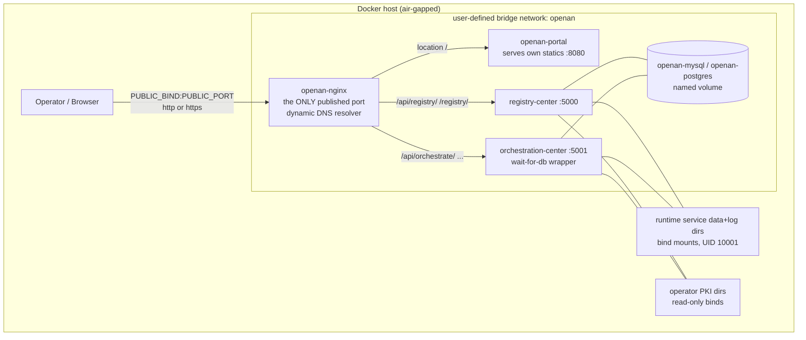
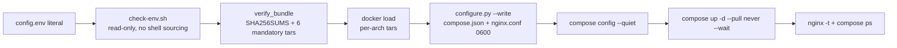

# Offline Compose Installation Architecture Design

## 1. Overview

The `containerized/offline-install-compose/` deliverable deploys the OpenAN
platform onto a **single air-gapped Docker host** — no Kubernetes at all —
from a self-contained bundle. It consists of two cooperating parts:

| Part | Artifact | Role |
|------|----------|------|
| Composition root | `scripts/configure.py` | Validates inputs and emits `runtime/compose.json` + `runtime/nginx.conf` (stdlib only, no shell eval) |
| Installer | `scripts/install.sh` (+ `check-env.sh`, `uninstall.sh`, `lib/common.sh`) | Loads images, runs configure, `docker compose up --wait` |

The generated Compose JSON is the **single deployment artifact** — there is
no hand-maintained YAML or nginx contract anywhere in the line
(`README.md:133-135`). The installer is explicit and repeatable: **no
prompts, no shell-evaluated config, no network pulls** (`install.sh:4`).

### Scope

- Target: one Linux host (amd64/arm64) with Docker + Compose v2.20+ and
  Python 3.10+ (stdlib only); run as root to provision UID 10001 runtime
  directories.
- One instance per application; **no HA is advertised** (`README.md:3-7`).
- External SQL is the production default; a bundled MySQL 8.4 (default) or
  PostgreSQL 15 is the self-contained option.

### Non-goals

- Kubernetes in any form (see `offline-install-architecture.md` for the K8s
  line).
- Interactive secret collection or `--skip-check` escape hatches
  (`README.md:53`).
- High availability, zero-downtime upgrades, model/workflow execution
  testing (the smoke test exercises transport and persistence, not
  business semantics).

---

## 2. Architecture

### 2.1 Deployment topology

- Single user-defined bridge network `openan`; no network aliases, no fixed
  IPs (so IPAM can replace backends freely).
- Only `openan-nginx` publishes a host port (`0.0.0.0:8080:80` by default;
  443 when public TLS). No application or SQL port is exposed.
- In `workflow-designer` mode there is no frontend container at all: nginx
  serves the extracted SPA from `bundle/web/`.

### 2.2 Service inventory

| Service | Image | Notes |
|---------|-------|-------|
| `openan-nginx` | `nginx:1.27.5-alpine` (pinned) | Entry, TLS termination, dynamic upstreams |
| `registry-center` | bundle tar | healthcheck `python -m agent_registry.healthcheck` |
| `orchestration-center` | bundle tar | wait-for-db wrapper command; healthcheck module |
| `openan-portal` | bundle tar (portal mode only) | env-only contract (`BACKEND_URL`/`REGISTRY_URL`), healthcheck wget |
| `openan-postgres` / `openan-mysql` | pinned (internal DB only) | named volume; **network** healthcheck probes |

Every service: `restart: unless-stopped`, `pull_policy: "never"` (the
offline guarantee at the Compose level), no resource limits, no extra
capabilities.

### 2.3 External dependencies

| Dependency | Notes |
|------------|-------|
| Docker + Compose v2 | `require_tools` also verifies a live daemon (`docker info`) and the compose plugin |
| python3 stdlib | configure.py deliberately uses no third-party packages |
| Operator-provided inputs | `config.env`, models.yaml files, runtime env files, PKI directories, credential file — all read-only binds; **the installer never changes source PKI ownership** (must be readable by UID 10001 without being world-readable, `README.md:113-118`) |

---

## 3. Component Design

### 3.1 configure.py — the composition root

**Literal config parsing** (`read_env`, lines 36-52): `KEY=VALUE` split on
the first `=`; keys match `[A-Z][A-Z0-9_]*`, duplicates are errors with
file:line; values are tokenized with `shlex.split(..., posix=True)` —
**dollar/backtick text is never executed or interpolated** (proved by the
secret-canary and `$(touch …)` contract tests). Unknown keys are rejected
outright — the config surface is closed.

**Managed-key firewall** (lines 324-334): runtime env files (per-service)
cannot override any managed key (`*_IP`, `*_PORT`, `DB_*`,
`PERSISTENCE_MODE`, `LLM_CONFIG_FILE`, …) nor create a second fact source
via `MYSQL_*/POSTGRES_*/REGISTRY_SSL_*`-style aliases. Merge order
`{**env, **managed}` means managed keys always win.

**Generation** (`write_plan`, lines 438-463):

- `runtime/` 0700; `runtime/<service>/{data,log}` created and, on POSIX as
  root, `os.chown(..., 10001, 10001)` — matching the containers' UID.
- Every `$` in every string becomes `$$` **before** serialization, because
  Compose interpolates even JSON — that is how literal `$` in passwords
  survives.
- `runtime/compose.json` and `runtime/nginx.conf` are opened with mode 0600
  at creation ("private permissions at creation, not after a world-readable
  write").

**Pre-start credential cross-check** (lines 376-391): for
`static_bearer`, configure.py recomputes
`hmac.new(HMAC_KEY, REGISTRY_ACCESS_TOKEN, sha256).hexdigest()` and scans
the credential file for an enabled, matching-identity `*.token_hash` entry
(constant-time compare). The plaintext token exists only in OC's env; the
credential file stores only the digest.

### 3.2 nginx entry (`nginx_config`, lines 110-207)

- **Dynamic upstream resolution**: `resolver 127.0.0.11 valid=2s` (Docker
  embedded DNS) with `server <svc>:<port> resolve` per upstream — backend
  replacement must not require a proxy restart (proven by the smoke test's
  replace-backends case, which asserts backend IPs changed while the nginx
  container ID did not).
- Exact-prefix `308` redirects plus `^~` prefix locations so SPA fallback
  and asset regexes can never swallow API paths.
- `X-OpenAN-Browser-Gateway "1"` on the API locations; standard forwarded
  headers; `gzip off; proxy_buffering off; proxy_read_timeout 3600s` for
  SSE; `client_max_body_size 50m`.
- Log format `safe` deliberately omits query strings ("may contain user
  intent"); `X-Content-Type-Options nosniff always`; `X-XSS-Protection`
  deliberately omitted (deprecated filter).
- TLS: public termination (optional `ssl_password_file`), and per-backend
  `proxy_ssl_name <service>` + optional `proxy_ssl_verify on` (depth 5,
  trusted CA) + optional client cert for upstream mTLS.

### 3.3 Frontend selection

| Aspect | `portal` (default) | `workflow-designer` |
|--------|--------------------|---------------------|
| Container | `openan-portal` added; image **pinned by the bundle manifest** `deps/image-tags.json`, never by operator config | none |
| Entry | `location / { proxy_pass http://openan-portal:8080; }` | `root /usr/share/nginx/html` + `try_files … /index.html`, hashed-asset immutable cache, `index.html` no-store |
| `/api/registry/` | proxied | not proxied |
| Requirement | portal tar present in bundle | `bundle/web/index.html` present |

Portal is **gracefully degraded at build time** (missing pull downgrades the
bundle to workflow-designer and omits portal from the manifest) and
**fails closed at install time** when `FRONTEND_TYPE=portal` is requested
without the image.

### 3.4 Databases

- External SQL is the default; internal mode adds `openan-mysql` (default,
  `mysql:8.4`) or `openan-postgres` (`postgres:15-alpine`) with a named
  volume and init scripts in `/docker-entrypoint-initdb.d/` creating both
  app databases/users (they run only on an empty volume).
- Healthchecks are **network probes** (`mysql --protocol=TCP` /
  `pg_isready -h openan-postgres`) — they prove the Docker network listener
  is ready, not just the loopback socket.
- OC's command is a **wait-for-database wrapper**: an `until python3 -c
  "<driver connect probe>"` loop, then `exec python3 -m orchestrate.start`.
  Rationale: root-level `SELECT 1` healthchecks can pass before the app
  user's grant propagates; the probe selects the driver from
  `PERSISTENCE_MODE` and reads credentials from the container environment,
  never from compose.json.
- MySQL init escapes passwords with `NO_BACKSLASH_ESCAPES` + doubled
  apostrophes, preserving backslashes/`$`/quotes.

### 3.5 Start gating

`depends_on: service_healthy` chains: apps → internal DB; OC → RC ("a slow
registry start cannot race OC's first contact"); nginx → both apps (+ portal
when present). Then `compose up --wait --wait-timeout 180` and a final
`nginx -t` inside the running entry container.

---

## 4. Data Flow

### 4.1 Install flow

### 4.2 Build flow (`build/build-offline.sh`)

- One **global tag** for all four app images (`--tag` or derived from
  `--source-ref`: `main` → `main-YYYYMMDD`); per-component tags are a
  K8s-line feature.
- `--app-source`: `pull` (registry), `build` (local source dir with
  Dockerfile, or release tarball URL, or GitHub archive for the ref;
  buildx per platform), or `tars` (prebuilt per-arch tars).
- **Portal is pull-only** — different pipeline (`containerized/build/portal/`);
  never built here.
- Every image is architecture-verified (`docker image inspect
  --format '{{.Os}}/{{.Architecture}}'`) before `docker save`.
- `bundle/web/` is extracted from the workflow-designer image with
  `docker create` + `docker cp` — without running the foreign-architecture
  frontend process.
- `deps/image-tags.json` records the arch list and image refs — the
  machine-readable manifest configure.py consumes (frontend images are
  pinned by the manifest, "unlike the Kubernetes line's frontend.image
  values").
- Output guard: refuses to overwrite an existing bundle dir/tar; a failed
  build never publishes anything. `SHA256SUMS` covers every bundle file
  (detects corruption, not authenticity).

### 4.3 Uninstall flow

`uninstall.sh` requires the generated `runtime/compose.json` ("refusing to
guess project identity") and runs `compose down --remove-orphans` — **no
`--volumes`**: database volumes, bind-mounted runtime data, PKI and
configuration are all preserved by design. Reinstall over preserved data
reuses it; upgrade = back up SQL + `runtime/`, then reinstall.

---

## 5. Configuration Contract

### 5.1 config.env (38 keys, closed surface)

Grouped summary (authoritative list: `DEFAULTS` in configure.py and
`config.env.example`):

| Group | Keys (representative) |
|-------|----------------------|
| Project / exposure | `PROJECT_NAME`, `PUBLIC_BIND`, `PUBLIC_PORT`, `PUBLIC_ENABLE_HTTPS`, `PUBLIC_TLS_DIR` |
| Frontend | `FRONTEND_TYPE` |
| Database | `DATABASE_TYPE` (mysql default), `DATABASE_INTERNAL`, `DB_HOST/DB_PORT`, `*_DB_{NAME,USERNAME,PASSWORD}`, `POSTGRES_PASSWORD` / `MYSQL_ROOT_PASSWORD` |
| Backend TLS | `REGISTRY_/ORCH_{ENABLE_HTTPS,VERIFY_CLIENT,TLS_DIR,PROXY_TLS_DIR}`, `BACKEND_VERIFY_SERVER`, `ORCH_CLIENT_VERIFY_SERVER`, `REGISTRY_CLIENT_TLS_DIR` |
| Registry identity | `REGISTRY_SIGN_ENABLED`, `REGISTRY_SIGN_DIR`, `REGISTRY_AUTH_MODE` (`static_bearer`/`oauth2_jwt`/`oauth2_introspection`), `REGISTRY_CREDENTIAL_FILE`, `REGISTRY_PUBLIC_BASE_URL` |
| Models / runtime env | `REGISTRY_/ORCH_MODELS_FILE`, `REGISTRY_/ORCH_RUNTIME_ENV_FILE`, `*_HEALTHCHECK_HOST` |

Everything fails closed: unknown keys, invalid ports/identifiers, missing
files/dirs, mismatched TLS prerequisites, unprovisioned tokens — all
rejected with `Configuration rejected: <reason>` before anything is
generated.

### 5.2 Secrets and keys

- Required runtime env: RC needs `INTEGRATION_FINGERPRINT_KEY` (+ HMAC key
  for static_bearer); OC needs `OC_ADMIN_INITIAL_PASSWORD` (seeds the SQL
  admin on first start; password change revokes sessions) and
  `REGISTRY_ACCESS_TOKEN` (paired with the credential-file digest by the
  pre-start cross-check).
- models.yaml, credential file, signing dir and TLS dirs are read-only
  binds; the plaintext token exists only in OC's env.

---

## 6. Security

| Control | Implementation |
|---------|----------------|
| No shell eval | config.env parsed by stdlib `read_env`; check-env reads `FRONTEND_TYPE` through importlib, never sourcing |
| No prompts / no `--skip-check` | install.sh accepts `--yes` and ignores it; there is nothing to skip |
| Secrets never printed | configure prints only "Configuration validated…"; install comment: "Do not print resolved config" |
| Offline guarantee | `docker load` only; `--pull never`; per-service `pull_policy: never` |
| File hygiene | `umask 077`; runtime 0700; generated JSON/nginx.conf 0600 **at creation**; bundle scripts 0755 (readable by the unprivileged DB entrypoint user) |
| Compose isolation | `run_compose` always passes `--project-name` from the generated compose.json (CLI precedence over a hostile `COMPOSE_PROJECT_NAME`), validated against `[a-z0-9][a-z0-9_-]*` |
| Password transport | `$`→`$$` escaping; psql variables / `NO_BACKSLASH_ESCAPES` in init scripts; verified end-to-end with awkward passwords in the smoke test |
| Bundle hygiene | secret-canary test plants a canary in every operator input and asserts no published tar contains it; `config.env`/`runtime/` never ship |
| TLS model | three independent switches (public / RC / OC); `*_VERIFY_CLIENT` requires HTTPS; verification opt-outs (`BACKEND_VERIFY_SERVER`, `ORCH_CLIENT_VERIFY_SERVER`) never remove mTLS material requirements nor disable Token identity |

---

## 7. Design Decisions

### D1: Why a generated compose.json instead of a static YAML?

Every deployment knob (DB type, three TLS switches, frontend type, ports,
credentials) changes services, volumes, binds and nginx together. A static
YAML plus an nginx template plus env plumbing would be three contracts to
keep in sync; configure.py computes all of them from one validated input,
and the contract tests assert the invariants of the output directly.

### D2: Why JSON and why `$$` escaping?

Compose accepts JSON as well as YAML, and JSON round-trips through the
stdlib without a YAML dependency (stdlib-only is a hard constraint on the
offline host). Compose still interpolates `$` inside JSON, so every literal
dollar is doubled before serialization — the only way passwords with `$`
survive.

### D3: Why does nginx resolve upstreams dynamically?

Backends restart with new IPs (no fixed IPs by design, so IPAM can replace
them). `resolver 127.0.0.11 valid=2s` + `server … resolve` keeps the proxy
correct without recreating it — proven by the smoke test, which replaces
both backends and asserts the nginx container ID is unchanged.

### D4: Why is external SQL the production default?

The Compose line targets a single host: a database container on the same
host adds no availability and complicates upgrades. The bundled DB exists
for self-contained evaluation, with named volumes that survive uninstall.

### D5: Why does uninstall preserve everything?

The line's data-safety posture: an uninstall must never destroy SQL data,
runtime artifacts or operator PKI. Operators who want removal do it
explicitly; upgrades document "back up, then reinstall".

### D6: Why UID 10001 provisioning in the installer?

The application containers run as UID 10001 with read-only mounts; their
writable `data/`/`log/` bind-mount hosts must be owned by that UID. Doing
the chown in configure.py (as root, before containers start) avoids both a
privileged init container and a first-run crash.

---

## 8. Testing Strategy

- **Contract tests** (`tests/test_offline_compose_contract.py`, no live
  Docker): a 64-case matrix (db × public TLS × per-backend TLS × frontend)
  asserting service sets, `pull_policy: never`, no app ports, managed env,
  mounts, healthchecks, nginx upstreams and headers; literal-config and
  dollar-survival proofs; the managed-key firewall; the secret-canary
  bundle test; hostile `COMPOSE_PROJECT_NAME` isolation; uninstall
  preserves volumes.
- **Container smoke** (`tests/offline_compose_container_smoke.py`, Linux +
  root, real end-to-end): a 10-case protocol matrix (plain, all-TLS,
  mixed directions, mTLS on/off, verify off) — real install, awkward
  passwords, signature verification inside the container, cookie `secure`
  flag, session revocation on password change, public-API auth model
  (cookie alone 401s; token endpoint yields a Bearer), SQL/file persistence
  across restart, backend replacement with DNS blockers occupying the freed
  IPs, audit-history survival. Framed as the release gate: "only a
  successful run for the exact revisions being released establishes
  coverage; render/unit tests are not Docker evidence" (`README.md:142-149`).

### Known documentation drift (flagged for cleanup)

- `build/README.md:37,55` still shows `--portal-src` (removed; the script
  rejects it) and claims a `--source-ref` default of `v1.0.0` — the Compose
  builder requires an explicit `--tag`/`--source-ref`.
