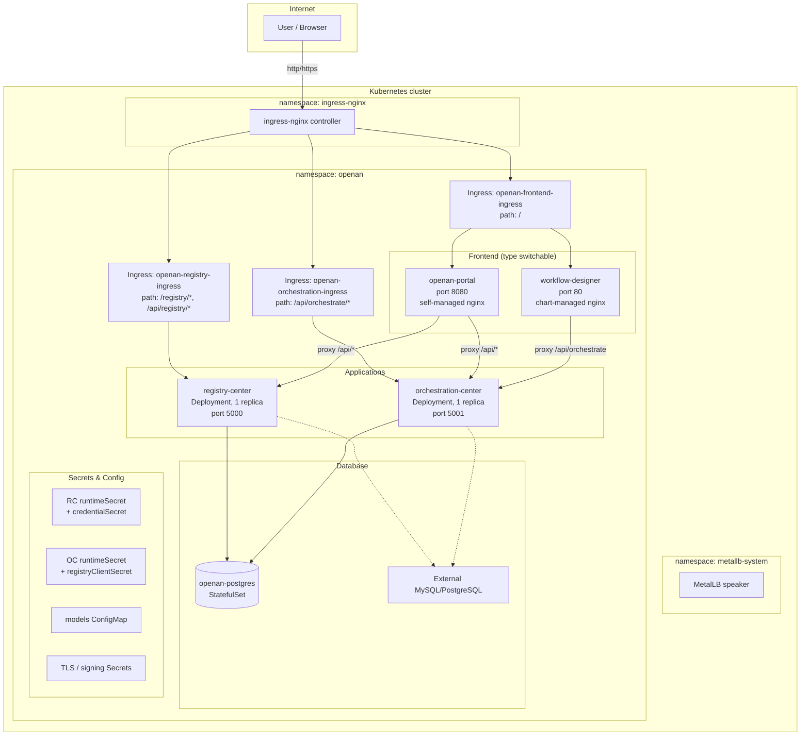
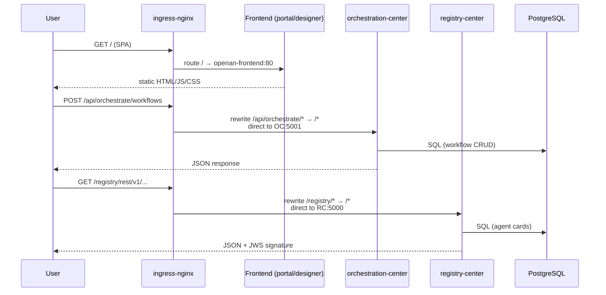
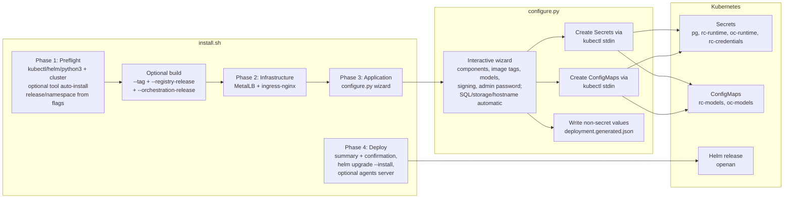
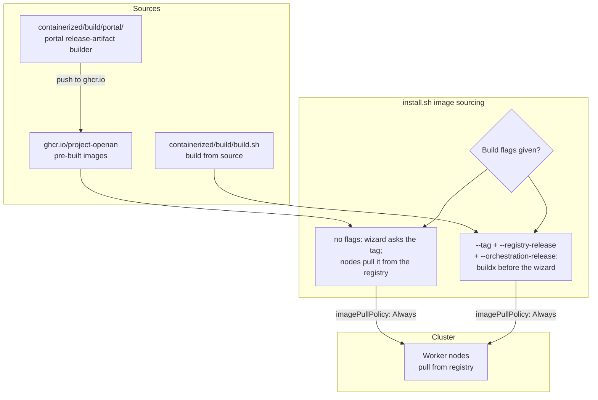
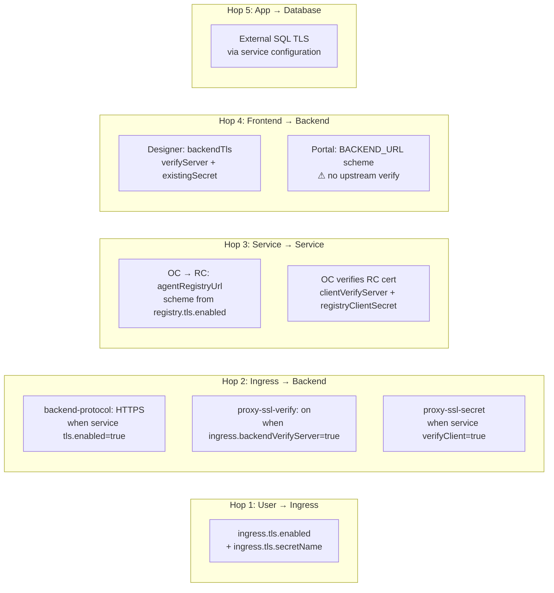

# Online Installation Architecture Design

## 1. Overview

The `containerized/online-install/` deliverable deploys the OpenAN platform
onto an existing Kubernetes cluster from a registry (internet-connected or
internal). It consists of two cooperating parts:

| Part | Artifact | Role |
|------|----------|------|
| Helm chart | `openan-chart/` | Declarative resource definitions; the single source of truth for what runs in the cluster |
| Installer | `install.sh` + `configure.py` | Orchestrates preflight, image sourcing, infrastructure, guided configuration, and `helm upgrade --install` |

The chart is the **production artifact** — it can be deployed directly with
`helm install -f deployment.yaml` and is the interface for GitOps. The
installer is a **convenience layer** for interactive evaluation and
scriptable CI; it never bypasses the chart.

### Scope

- Target: a running Kubernetes cluster (v1.25+), internet-connected.
- The installer provisions MetalLB and ingress-nginx (or skips them) but
  does not create the cluster itself.
- Portal image is pulled from a registry (never built from source here); see
  `containerized/build/portal/` for the dedicated portal builder.

### Non-goals

- Cluster creation (see `containerized/offline-install/docs/KUBEADM_CLUSTER.md`).
- Offline/air-gapped deployment (see `offline-install-architecture.md` for
  the Kubernetes line and `offline-install-compose-architecture.md` for the
  Docker Compose line).
- Image building for registry-center/orchestration-center (see
  `containerized/build/build.sh`); the installer can invoke it but does not
  own the logic.

---

## 2. Architecture

### 2.1 Deployment topology



### 2.2 Component inventory

| Resource | Kind | Name | Notes |
|----------|------|------|-------|
| Registry Center | Deployment | `registry-center` | 1 replica (process-local events); Recreate strategy |
| Orchestration Center | Deployment | `orchestration-center` | 1 replica (process-local sessions); Recreate strategy |
| Frontend (portal) | Deployment | `openan-frontend` | 2 replicas default; HPA enabled |
| Frontend (designer) | Deployment | `openan-frontend` | 2 replicas default; HPA enabled; chart-managed nginx |
| PostgreSQL | StatefulSet | `openan-postgres` | Only when `postgresql.enabled=true` |
| RC runtime PVC | PVC | `registry-center-runtime` | `helm.sh/resource-policy: keep` |
| OC runtime PVC | PVC | `orchestration-center-runtime` | `helm.sh/resource-policy: keep` |
| Local PVs (fallback) | PV | `openan-postgres-pv`, `openan-rc-pv`, `openan-oc-pv` | Only when `createPV` is set; node-pinned hostPath/local, single-node evaluation |
| Frontend Ingress | Ingress | `openan-frontend-ingress` | path `/` |
| Orchestration Ingress | Ingress | `openan-orchestration-ingress` | path `/api/orchestrate(/|$)(.*)` → rewrite |
| Registry Ingress | Ingress | `openan-registry-ingress` | paths `/registry`, `/api/registry` → rewrite |
| Validation | Template | `validate.yaml` | `fail`-time contract enforcement |

### 2.3 External dependencies

| Dependency | Managed by | Notes |
|------------|-----------|-------|
| ingress-nginx | Installer phase [2/4] or operator | Must have `ingressClassName: nginx` |
| MetalLB | Installer phase [2/4] or operator | Only needed on bare-metal for LoadBalancer IP |
| Container images | `ghcr.io/project-openan` (default) | `frontend.image.repository` empty → derived by `frontend.type` |
| External SQL | Operator-provisioned | MySQL or external PostgreSQL via `database.type` (reviewed values; the wizard is in-cluster only) |
| StorageClass | Operator-provisioned | The wizard falls back to node-pinned local hostPath PVs when none exists |

---

## 3. Component Design

### 3.1 Registry Center (Deployment)

**Responsibility**: Agent Card registration, discovery, semantic search,
JWS signing, token/certificate identity.

**Key design decisions**:

- **Single replica enforced** — runtime event listeners and dispatchers are
  process-local; `validate.yaml:37` `fail`s on `replicas != 1` until
  distributed coordination exists.
- **Recreate strategy** — not RollingUpdate: RWO runtime PVC cannot be
  shared across pods during surge.
- **Non-root security context** — `runAsUser: 10001`, all capabilities
  dropped, `allowPrivilegeEscalation: false`.
- **Init container** prepares `/runtime/{data,log}` directory permissions
  before the main container starts (fsGroup handles group access, but the
  init container guarantees the directories exist with mode 0770).
- **Config checksum annotations** — `checksum/config` and `checksum/models`
  on the pod template force a rollout when the ConfigMap or models.yaml
  changes, without requiring image tag changes.

**Volume layout**:

| Volume | Source | Mount | Purpose |
|--------|--------|-------|---------|
| `runtime` | PVC (retained) | `/opt/registry-center/data`, `/opt/registry-center/log` | Persistent data & logs |
| `models` | ConfigMap | `/opt/registry-center/etc/config/models.yaml` (subPath) | LLM model definitions |
| `tls` | Secret (0440) | `/opt/registry-center/etc/ssl/{server.cer,...}` (subPath per key) | TLS material |
| `signing` | Secret (0440) | `/opt/registry-center/etc/sign_cert/{sign.cer,...}` | JWS signing keys |
| `credentials` | Secret (0440) | `/opt/registry-center/etc/conf/integration_credentials.conf` | Static Bearer / mTLS entries |

### 3.2 Orchestration Center (Deployment)

**Responsibility**: PSOP generation, workflow execution, SSE streaming,
admin user bootstrap, agent orchestration.

**Key design decisions**:

- **Single replica + no HPA** — sessions are process-local (in-memory);
  `validate.yaml:45` `fail`s on `replicas != 1` or `hpa.enabled=true`.
- **Recreate strategy** — same RWO PVC reason as RC.
- **`agentRegistryUrl` auto-discovery** — the `openan.registryUrl` helper
  derives `http(s)://registry-center:<port>` from the registry's TLS setting;
  users can override with an external URL.
- **`clientVerifyServer`** — controls whether OC verifies the registry's TLS
  certificate; requires `registryClientSecret` (trust.cer + optional client
  cert) when the registry runs HTTPS.

**Volume layout**: identical pattern to RC (runtime PVC, models ConfigMap, TLS
Secret, registry client Secret). No signing volume (signing is RC-only).

### 3.3 Frontend (Deployment, type-switchable)

**Responsibility**: unified web entry; serves the SPA and proxies API calls
to the backends.

**Two modes via `frontend.type`**:

| Aspect | `portal` (default) | `workflow-designer` |
|--------|-------------------|---------------------|
| Image | `ghcr.io/project-openan/openan-portal` | `ghcr.io/project-openan/workflow-designer` |
| Container port | 8080 (unprivileged nginx) | 80 |
| Nginx config | Self-managed (envsubst template in the image) | Chart-managed (ConfigMap, checksum rollout) |
| Env | `BACKEND_URL`, `REGISTRY_URL` (scheme follows per-backend TLS) | None (nginx config baked in) |
| Upstream TLS verify | ❌ Portal image cannot verify upstream TLS | ✅ `backendTls.existingSecret` (ca.crt + optional client cert) |
| Volumes | None | nginx-config ConfigMap, backend-tls Secret |

**Design rationale for the switch**: portal uses a fundamentally different
build pipeline (npm → static → nginx) and is built/published separately
(`containerized/build/portal/`). The chart only needs to know the container
port and the env contract — everything else is the image's responsibility.
The `openan.frontendImageRepository` helper derives the image from the type
when `repository` is empty, keeping values minimal.

### 3.4 PostgreSQL (StatefulSet)

Only rendered when `postgresql.enabled=true` and `database.type=postgresql`.

- Creates two databases/users via init script (`postgresql.databases` list).
- Both apps share the `postgres-password` (in-cluster mode); per-app
  `existingSecret` is rejected for in-cluster PG (validate.yaml:70).
- Storage: default StorageClass, or explicit `storageClassName`, or `-`
  (no class). Without any StorageClass, `postgresql.storage.createStorageClass`
  + `createPV`/`useHostPath`/`nodeName` create the shared `openan-local`
  class and a node-pinned PV (single-node evaluation; the wizard enables
  this automatically).

### 3.5 Runtime PVCs (`runtime-pvc.yaml`)

Each of RC and OC gets a dedicated PVC (`<name>-runtime`) with
`helm.sh/resource-policy: keep` — uninstalling the Helm release does NOT
delete runtime data. This is a data-safety decision: the PVC outlives the
chart lifecycle. On clusters without a StorageClass,
`persistence.createPV` (plus `storageClassName`, `useHostPath`, `nodeName`,
`pvName`) renders a matching node-pinned PV (`openan-rc-pv` /
`openan-oc-pv`) so the claims bind; single-node evaluation only, and
`uninstall.sh` detects and cleans these PVs and their hostPath data.

---

## 4. Data Flow

### 4.1 Request flow (user → backend)



**Key insight**: the frontend proxies `/api/orchestrate` and `/api/registry`
in-pod (for SPA-originated calls), but the Ingress also routes these paths
directly to the backends (for API consumers that bypass the frontend). Both
paths coexist without conflict.

### 4.2 Configuration flow (installer → cluster)



**Secret handling**: `configure.py` uses `getpass` (TTY-guarded) for input,
creates Secrets via `kubectl create -f -` with JSON through stdin — secrets
never appear in command-line arguments, environment files, or values files.
The generated values file (`deployment.generated.json`) contains only
non-secret references (Secret/ConfigMap names, image tags, hosts).

**Agent examples server**: when orchestration is deployed, the installer
interactively offers to start the demo agents (`samples/start_agents_server.py`)
inside the orchestration-center pod via `kubectl exec` + `nohup`, then
health-checks port 8903 (log: `/tmp/agents-server.log`). It mirrors the
offline installer's `START_AGENTS_SERVER` option but is a post-deploy
convenience, not a chart resource: it is not reconciled by Helm and does not
survive pod restarts or upgrades.

**Preflight auto-install and deploy gate**: missing kubectl/helm are offered
for automatic installation — official installers only (`dl.k8s.io` binary,
`get-helm-3`, `brew` on macOS when present), behind an explicit interactive
confirmation, with a re-check after installation; python3 always stays
manual, and Docker (get.docker.com, Linux) is only offered inside the
flag-driven build phase. Nothing is installed on the host without a "yes".
Before `helm upgrade --install`, the installer prints a non-secret
deployment summary (release/namespace, components, image tags, SQL,
storage, models, signing, ingress host) and requires confirmation;
cancelling keeps the generated values file and the Secrets/ConfigMaps the
wizard already created (the wizard is not transactional). Neither behavior
exists in the non-interactive `--values` mode: CI fails fast on missing
tools and deploys without prompts.

### 4.3 Image flow



Portal is **never** built from source by the installer — it is pulled from
the registry. The dedicated portal builder (`containerized/build/portal/`)
handles the source-to-image pipeline and publishes to ghcr.io.

---

## 5. Configuration Contract

### 5.1 Values schema (top-level)

```yaml
namespace: string            # Must match helm --namespace (validated)
createNamespace: boolean
postgresql: {...}           # In-cluster PG (optional)
database: {...}             # SQL type/host/port + per-app db/user/secret
registry: {...}             # RC: image, port, replicas, llm, tls, signing, persistence
orchestration: {...}        # OC: image, port, replicas, llm, tls, persistence
frontend: {...}             # type, image, port, nodePort, nginxConfig, backendTls
ingress: {...}              # enabled, className, host, tls, annotations
```

### 5.2 Secret reference model

The chart **never generates credentials**. Every secret is a reference to
an existing Kubernetes Secret:

| Secret | Key(s) | Referenced by |
|--------|--------|---------------|
| `postgresql.existingSecret` | `postgres-password` | RC/OC DB_PASSWORD (in-cluster PG) |
| `database.<app>.existingSecret` | `db-password` (or `passwordKey`) | Per-app DB_PASSWORD (external SQL) |
| `registry.runtimeSecret` | env vars (envFrom wholesale) | RC pod |
| `registry.credentialSecret` | `integration_credentials.conf` | RC pod (mounted file) |
| `registry.tls.existingSecret` | `server.cer`, `server_key.pem`, `cert_pwd`, `trust.cer` | RC pod (mounted files) |
| `registry.signing.existingSecret` | `sign.cer`, `sign_key.pem`, `cert_pwd` | RC pod (mounted files) |
| `orchestration.runtimeSecret` | `OC_ADMIN_INITIAL_PASSWORD`, `REGISTRY_ACCESS_TOKEN` | OC pod (envFrom) |
| `orchestration.registryClientSecret` | `trust.cer`, `client.cer`, `client_key.pem` | OC → RC TLS |
| `orchestration.tls.existingSecret` | Same as RC TLS | OC pod |
| `frontend.backendTls.existingSecret` | `trust.cer` (+ `client.cer`, `client_key.pem`) | Designer nginx upstream verify |

### 5.3 ConfigMap reference model

| ConfigMap | Content | Referenced by |
|----------|---------|---------------|
| `registry.modelsConfigMap` | `models.yaml` (full LLM config) | RC pod (subPath mount) |
| `orchestration.modelsConfigMap` | `models.yaml` | OC pod (subPath mount) |
| `openan-frontend-nginx-config` | `default.conf` (nginx) | Designer pod (designer mode only) |

### 5.4 Validation rules (`validate.yaml`)

The `validate.yaml` template is a **fail-fast contract enforcer** that runs
at `helm template/lint/install` time. It rejects:

- Missing image tags (no default tag — forces explicit pinning)
- MySQL with `postgresql.enabled=true` (contradictory)
- RC/OC with the same external database name
- RC/OC without `runtimeSecret`
- `verifyClient=true` without TLS
- Portal frontend type with OC TLS + `backendTls.verifyServer` (portal
  cannot verify upstream TLS — documented limitation)
- RC replicas > 1 (process-local events)
- OC replicas > 1 or HPA enabled (process-local sessions)
- In-cluster PG with per-app `existingSecret` (in-cluster uses one shared
  password)
- `persistence.createPV` without a matching `storageClassName`, or a local
  (non-hostPath) PV without `nodeName` (the PV and PVC could not bind)
- Probe timeouts below 3s on liveness/readiness/startup probes
- Duplicate `extraEnv` keys that shadow managed settings
- Probe host that shadows another service or the SQL host

---

## 6. Security

### 6.1 Authentication model

The chart supports two caller-identity modes for registry-center:

| Mode | Mechanism | Requirements |
|------|-----------|-------------|
| `token` (default) | Bearer token via `integration.auth.*` provider | `credentialSecret` with `integration_credentials.conf` |
| `certificate` | Client certificate mTLS | `tls.enabled=true` + `tls.verifyClient=true` |

Orchestration-center has its own authentication:

| Path | Mechanism | Secret |
|------|-----------|--------|
| `/api/v1/*` (external) | Session login (admin user) + Bearer tokens | `OC_ADMIN_INITIAL_PASSWORD` in runtimeSecret |
| `/rest/v1/orchestrate/*` (internal) | Service token to RC | `REGISTRY_ACCESS_TOKEN` in runtimeSecret |

### 6.2 TLS architecture

TLS is layered and independently switchable per hop:



**Key design decision**: each hop's TLS is independent. You can have TLS at
the ingress (Hop 1) with plain HTTP to backends (Hop 2 off), or mTLS between
services (Hop 3 on) with a plain HTTP ingress. This granularity is necessary
because certificates differ per hop (public CA at ingress, internal CA
between services, database CA for SQL).

**Known limitation**: the portal image cannot verify upstream TLS (no CA
injection point). When `frontend.type=portal` and OC runs HTTPS, the
connection is made but unverified. `validate.yaml` scopes the `backendTls`
requirement to `workflow-designer` only.

### 6.3 JWS signing

Registry-center signs every AgentCard with a JWS. The signing material is
independent of TLS:

| `signing.mode` | Behavior |
|---------------|----------|
| `auto` | Helm generates self-signed material (demo only) |
| `secret` | Reference existing Secret with `sign.cer`, `sign_key.pem`, `cert_pwd` |
| `off` | No signing volume mounted |

### 6.4 Pod security

All application pods run with:

- `runAsUser: 10001`, `runAsGroup: 10001`, `fsGroup: 10001`
- `allowPrivilegeEscalation: false`
- `capabilities: drop: ["ALL"]`
- Secret volumes mounted `readOnly: true` with `defaultMode: 0440`
- Init container for directory permission setup

---

## 7. Design Decisions

### D1: Why one chart, not subcharts?

All components share the `database` block and the `frontend`/`ingress`
configuration. Splitting into subcharts would require duplicating the database
contract or introducing umbrella-chart complexity. The current flat structure keeps every
dependency visible in one `values.yaml`.

### D2: Why `Recreate` instead of `RollingUpdate`?

RC and OC each mount a `ReadWriteOnce` PVC. `RollingUpdate` with surge
creates a new pod that cannot mount the same volume, causing the new pod to
be stuck in `Pending` and the old pod to be killed only after the new one is
ready — the rollout deadlocks. `Recreate` (kill all, then create) is the
correct strategy for single-replica RWO deployments.

### D3: Why secrets via envFrom wholesale?

`runtimeSecret` is consumed via `envFrom: secretRef`, meaning every key in
the Secret becomes an environment variable. This is deliberate: the services
(registry-center, orchestration-center) evolve their env contract independently
of the chart. Adding a new credential (e.g., a new OAuth client) only
requires adding a key to the Secret — no chart change needed.

### D4: Why `validate.yaml` instead of admission webhooks?

Admission webhooks require deployment infrastructure (a webhook server, TLS,
RBAC). Helm-native `fail` provides compile-time validation with zero runtime
dependencies. The tradeoff is that validation only runs during
`helm template/lint/install` — not on subsequent `kubectl apply` of raw
manifests. For the GitOps workflow (helm-only), this is sufficient.

### D5: Why portal is pull-only?

Portal's build pipeline (npm → Vite build → static assets → nginx image) is
fundamentally different from the Python services. Embedding this in the
offline/shared builders would:
- Add Node.js as a build dependency
- Require knowledge of the portal's npm workspace layout
- Couple chart releases to portal source changes

Instead, portal images are built by the dedicated
`containerized/build/portal/build-portal-image.sh` and published to a
registry. All build entrypoints (shared, offline K8s, offline Compose) pull
the pre-built image — the chart only provides `BACKEND_URL`/`REGISTRY_URL`.

### D6: Why `namespace` must match Helm `--namespace`?

The chart writes `namespace:` in every resource spec explicitly. If this
differed from the Helm namespace, `helm uninstall` would not clean up
correctly, and cross-namespace references (Secrets, PVCs) would fail.
`validate.yaml:7` enforces this at render time.

---

## 8. Extensibility

### 8.1 Adding a new backend component

1. Add a `values.yaml` block (image, port, replicas, tls, persistence).
2. Create `templates/<name>/deployment.yaml` + `service.yaml` +
   `configmap.yaml` (+ optional `secret.yaml`, `hpa.yaml`).
3. Add labels/selectorLabels helpers in `_helpers.tpl`.
4. Add validation rules in `validate.yaml`.
5. Add ingress path in `ingress.yaml` (if externally reachable).
6. Add contract tests in `tests/test_deployment_contract.py`.

### 8.2 Adding a new database backend

The `database.type` field is open (currently `postgresql`|`mysql`). Add the
new type to `validate.yaml`, add connection logic in the helpers, and update
the deployment env wiring.

### 8.3 Adding a new frontend type

Add the type name to `openan.frontendType`, set the container port in
`openan.frontendContainerPort`, set the image default in
`openan.frontendImageRepository`, and add the mode branch in the frontend
Deployment template.

### 8.4 Known non-goals

- **Multi-replica RC** — blocked on distributed event coordination.
- **Multi-replica OC** — blocked on shared session storage.
- **Chart-level image pulling** — the chart assumes images exist in the
  registry; it never builds.
- **Namespace-scoped RBAC** — the chart runs with the Helm service account;
  fine-grained RBAC is left to the operator.

### 8.5 Testing strategy

All contract tests (`tests/test_deployment_contract.py`) use real `helm
template` rendering — not mocks — and assert on the rendered YAML. This
ensures the chart is valid against real Helm behavior. The Compose contract
tests (`tests/test_offline_compose_contract.py`) verify the Compose generator's
output matches the same architectural decisions.
